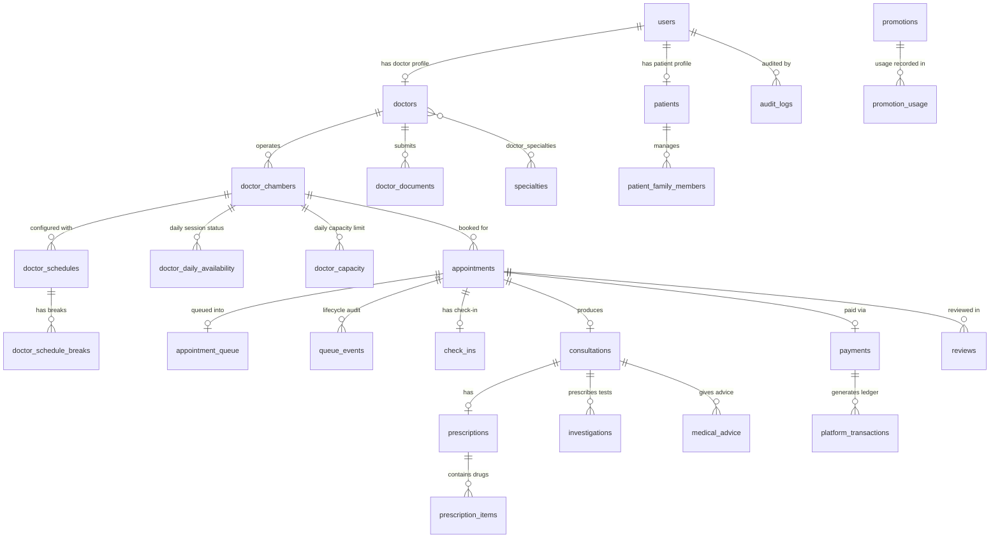

# MEDIQ — Database Specification & Schema Architecture

## 1. Relational Database Overview & Integrity Standards
- **Engine**: MySQL 8.0+ / MariaDB 10.4+ (InnoDB Storage Engine).
- **Charset / Collation**: `utf8mb4` / `utf8mb4_unicode_ci` (Full Unicode support for Bangla doctor names, symptoms, and chamber addresses).
- **Timezone Storage**: Standardized to `Asia/Dhaka` (UTC+6). All date, time, and timestamp columns evaluate in this context.
- **Transactions & Locking**: Pessimistic row locking (`SELECT ... FOR UPDATE`) is mandated for capacity checks, token issuance, and payment webhooks.
- **Price Immutability**: All monetary transactions (consultation fee, platform fee, discount applied) are copied directly into the `appointments` and `payments` tables at transaction time. Modifying doctor or platform fee settings never alters historical records.

---

## 2. Entity Relationship Diagram (ERD)

---

## 3. Comprehensive Database Table Plan

### 3.1 User & Identity Management

#### `users`
| Column | Type | Attributes | Description |
| :--- | :--- | :--- | :--- |
| `id` | BIGINT UNSIGNED | PK, AUTO_INCREMENT | Unique user identifier |
| `role` | ENUM('PATIENT','DOCTOR','PLATFORM_ADMIN') | NOT NULL | Strict user role |
| `full_name` | VARCHAR(120) | NOT NULL | User's full legal name |
| `email` | VARCHAR(150) | NULL, UNIQUE | User email address |
| `phone` | VARCHAR(20) | NOT NULL, UNIQUE | Primary mobile phone |
| `password_hash` | VARCHAR(255) | NOT NULL | BCrypt password hash |
| `status` | ENUM('ACTIVE','SUSPENDED','DEACTIVATED') | DEFAULT 'ACTIVE' | Account status |
| `profile_photo` | VARCHAR(255) | NULL | Relative path to profile image |
| `email_verified_at` | TIMESTAMP | NULL | Email verification timestamp |
| `phone_verified_at` | TIMESTAMP | NULL | Phone OTP verification timestamp |
| `last_login_at` | TIMESTAMP | NULL | Last login timestamp |
| `created_at` | TIMESTAMP | DEFAULT CURRENT_TIMESTAMP | Record creation timestamp |
| `updated_at` | TIMESTAMP | DEFAULT CURRENT_TIMESTAMP ON UPDATE CURRENT_TIMESTAMP | Last update |

*Indexes*: `INDEX idx_users_role (role)`, `INDEX idx_users_phone (phone)`.

---

### 3.2 Doctor & Verification Management

#### `doctors`
| Column | Type | Attributes | Description |
| :--- | :--- | :--- | :--- |
| `id` | BIGINT UNSIGNED | PK, AUTO_INCREMENT | Doctor profile identifier |
| `user_id` | BIGINT UNSIGNED | NOT NULL, UNIQUE, FK -> `users(id)` ON DELETE CASCADE | Associated user record |
| `bmdc_number` | VARCHAR(50) | NOT NULL, UNIQUE | Bangladesh Medical & Dental Council reg no |
| `medical_reg_no` | VARCHAR(50) | NULL | Secondary medical registration number |
| `designation` | VARCHAR(150) | NOT NULL | Title/degrees (e.g. MBBS, FCPS, MD) |
| `experience_years` | SMALLINT UNSIGNED | DEFAULT 0 | Years of medical practice |
| `consultation_fee` | DECIMAL(10,2) | NOT NULL | New patient consultation fee (BDT) |
| `follow_up_fee` | DECIMAL(10,2) | NOT NULL | Follow-up patient fee (BDT) |
| `follow_up_validity_days` | SMALLINT UNSIGNED | DEFAULT 30 | Window in days eligible for follow-up fee |
| `bio` | TEXT | NULL | Professional biography |
| `languages` | VARCHAR(255) | DEFAULT 'Bangla, English' | Spoken languages |
| `verification_status` | ENUM('PENDING','UNDER_REVIEW','VERIFIED','REJECTED','SUSPENDED') | DEFAULT 'PENDING' | Administrative verification state |
| `verification_notes` | TEXT | NULL | Internal admin notes on credential check |
| `verified_at` | TIMESTAMP | NULL | Timestamp of official verification |
| `verified_by` | BIGINT UNSIGNED | NULL, FK -> `users(id)` | Admin who verified credentials |
| `signature_path` | VARCHAR(255) | NULL | Secure path to doctor's digital signature |
| `rating_avg` | DECIMAL(3,2) | DEFAULT 0.00 | Average review score (1.00 - 5.00) |
| `rating_count` | INT UNSIGNED | DEFAULT 0 | Count of approved patient reviews |
| `created_at` | TIMESTAMP | DEFAULT CURRENT_TIMESTAMP | |
| `updated_at` | TIMESTAMP | DEFAULT CURRENT_TIMESTAMP ON UPDATE CURRENT_TIMESTAMP | |

*Indexes*: `INDEX idx_doctors_verification (verification_status)`, `INDEX idx_doctors_rating (rating_avg)`.

#### `doctor_documents`
| Column | Type | Attributes | Description |
| :--- | :--- | :--- | :--- |
| `id` | BIGINT UNSIGNED | PK, AUTO_INCREMENT | |
| `doctor_id` | BIGINT UNSIGNED | NOT NULL, FK -> `doctors(id)` ON DELETE CASCADE | |
| `doc_type` | ENUM('BMDC_CERT','NID','DEGREE_CERT','OTHER') | NOT NULL | Document category |
| `file_path` | VARCHAR(255) | NOT NULL | Path in private storage |
| `mime_type` | VARCHAR(50) | NOT NULL | MIME validation |
| `file_size` | INT UNSIGNED | NOT NULL | File size in bytes |
| `verified_at` | TIMESTAMP | NULL | |
| `verified_by` | BIGINT UNSIGNED | NULL, FK -> `users(id)` | |
| `created_at` | TIMESTAMP | DEFAULT CURRENT_TIMESTAMP | |

---

### 3.3 Patient & Family Management

#### `patients`
| Column | Type | Attributes | Description |
| :--- | :--- | :--- | :--- |
| `id` | BIGINT UNSIGNED | PK, AUTO_INCREMENT | Patient profile identifier |
| `user_id` | BIGINT UNSIGNED | NOT NULL, UNIQUE, FK -> `users(id)` ON DELETE CASCADE | Associated user account |
| `dob` | DATE | NULL | Date of birth |
| `gender` | ENUM('MALE','FEMALE','OTHER') | NULL | Gender |
| `blood_group` | ENUM('A+','A-','B+','B-','AB+','AB-','O+','O-') | NULL | Blood group |
| `address` | TEXT | NULL | Residential address |
| `emergency_contact_name` | VARCHAR(120) | NULL | Emergency contact name |
| `emergency_contact_phone` | VARCHAR(20) | NULL | Emergency contact mobile |
| `created_at` | TIMESTAMP | DEFAULT CURRENT_TIMESTAMP | |
| `updated_at` | TIMESTAMP | DEFAULT CURRENT_TIMESTAMP ON UPDATE CURRENT_TIMESTAMP | |

#### `patient_family_members`
| Column | Type | Attributes | Description |
| :--- | :--- | :--- | :--- |
| `id` | BIGINT UNSIGNED | PK, AUTO_INCREMENT | Family member record identifier |
| `patient_id` | BIGINT UNSIGNED | NOT NULL, FK -> `patients(id)` ON DELETE CASCADE | Managing primary patient |
| `full_name` | VARCHAR(120) | NOT NULL | Full name |
| `relationship` | ENUM('FATHER','MOTHER','SPOUSE','CHILD','SIBLING','OTHER') | NOT NULL | Relationship to patient |
| `dob` | DATE | NULL | Date of birth |
| `gender` | ENUM('MALE','FEMALE','OTHER') | NOT NULL | Gender |
| `blood_group` | ENUM('A+','A-','B+','B-','AB+','AB-','O+','O-') | NULL | Blood group |
| `emergency_info` | TEXT | NULL | Medical allergies or special notes |
| `created_at` | TIMESTAMP | DEFAULT CURRENT_TIMESTAMP | |
| `updated_at` | TIMESTAMP | DEFAULT CURRENT_TIMESTAMP ON UPDATE CURRENT_TIMESTAMP | |

*Indexes*: `INDEX idx_family_patient (patient_id)`.

---

### 3.4 Taxonomy & Location

#### `specialties`
| Column | Type | Attributes | Description |
| :--- | :--- | :--- | :--- |
| `id` | INT UNSIGNED | PK, AUTO_INCREMENT | |
| `name` | VARCHAR(100) | NOT NULL | Specialty name (e.g. Cardiology) |
| `slug` | VARCHAR(100) | NOT NULL, UNIQUE | URL slug (e.g. cardiology) |
| `icon` | VARCHAR(255) | NULL | SVG icon identifier |
| `description` | TEXT | NULL | Short summary |
| `is_active` | BOOLEAN | DEFAULT TRUE | System visibility toggle |

#### `doctor_specialties`
| Column | Type | Attributes | Description |
| :--- | :--- | :--- | :--- |
| `doctor_id` | BIGINT UNSIGNED | NOT NULL, FK -> `doctors(id)` ON DELETE CASCADE | |
| `specialty_id` | INT UNSIGNED | NOT NULL, FK -> `specialties(id)` ON DELETE CASCADE | |
| `is_primary` | BOOLEAN | DEFAULT FALSE | Main specialty badge |
| PRIMARY KEY (`doctor_id`, `specialty_id`) | | | |

#### `cities` & `areas`
- `cities`: `id`, `name`, `division`, `is_active`.
- `areas`: `id`, `city_id` (FK), `name`, `postal_code`, `is_active`.

---

### 3.5 Chambers, Schedules & Capacity

#### `doctor_chambers`
| Column | Type | Attributes | Description |
| :--- | :--- | :--- | :--- |
| `id` | BIGINT UNSIGNED | PK, AUTO_INCREMENT | Chamber identifier |
| `doctor_id` | BIGINT UNSIGNED | NOT NULL, FK -> `doctors(id)` ON DELETE CASCADE | Operating doctor |
| `name` | VARCHAR(150) | NOT NULL | Chamber / hospital name |
| `address` | TEXT | NOT NULL | Detailed physical address |
| `city_id` | INT UNSIGNED | NOT NULL, FK -> `cities(id)` | City location |
| `area_id` | INT UNSIGNED | NOT NULL, FK -> `areas(id)` | Area location |
| `latitude` | DECIMAL(10,8) | NULL | Geo-coordinate latitude |
| `longitude` | DECIMAL(11,8) | NULL | Geo-coordinate longitude |
| `contact_phone` | VARCHAR(20) | NOT NULL | Chamber reception contact |
| `room_number` | VARCHAR(50) | NULL | Room/floor number |
| `token_prefix` | VARCHAR(5) | DEFAULT 'A' | Prefix for serial display (e.g. 'A', 'B') |
| `is_active` | BOOLEAN | DEFAULT TRUE | Active chamber toggle |
| `created_at` | TIMESTAMP | DEFAULT CURRENT_TIMESTAMP | |
| `updated_at` | TIMESTAMP | DEFAULT CURRENT_TIMESTAMP ON UPDATE CURRENT_TIMESTAMP | |

*Indexes*: `INDEX idx_chambers_doc (doctor_id)`, `INDEX idx_chambers_location (city_id, area_id)`.

#### `doctor_schedules`
| Column | Type | Attributes | Description |
| :--- | :--- | :--- | :--- |
| `id` | BIGINT UNSIGNED | PK, AUTO_INCREMENT | |
| `doctor_id` | BIGINT UNSIGNED | NOT NULL, FK -> `doctors(id)` ON DELETE CASCADE | |
| `chamber_id` | BIGINT UNSIGNED | NOT NULL, FK -> `doctor_chambers(id)` ON DELETE CASCADE | |
| `day_of_week` | TINYINT UNSIGNED | NOT NULL | 0=Sunday, 1=Monday, ..., 6=Saturday |
| `start_time` | TIME | NOT NULL | Chamber consultation start |
| `end_time` | TIME | NOT NULL | Chamber consultation end |
| `slot_duration_minutes`| SMALLINT UNSIGNED | DEFAULT 10 | Target consultation duration per patient |
| `default_capacity` | SMALLINT UNSIGNED | NOT NULL | Default max patients per session |
| `is_active` | BOOLEAN | DEFAULT TRUE | Active schedule toggle |
| UNIQUE KEY `uk_doc_chamber_day` (`doctor_id`, `chamber_id`, `day_of_week`) | | | |

#### `doctor_schedule_breaks`
| Column | Type | Attributes | Description |
| :--- | :--- | :--- | :--- |
| `id` | BIGINT UNSIGNED | PK, AUTO_INCREMENT | |
| `schedule_id` | BIGINT UNSIGNED | NOT NULL, FK -> `doctor_schedules(id)` ON DELETE CASCADE | |
| `start_time` | TIME | NOT NULL | Break start time |
| `end_time` | TIME | NOT NULL | Break end time |
| `label` | VARCHAR(100) | DEFAULT 'Prayer/Snack Break' | |

#### `doctor_daily_availability`
| Column | Type | Attributes | Description |
| :--- | :--- | :--- | :--- |
| `id` | BIGINT UNSIGNED | PK, AUTO_INCREMENT | |
| `doctor_id` | BIGINT UNSIGNED | NOT NULL, FK -> `doctors(id)` | |
| `chamber_id` | BIGINT UNSIGNED | NOT NULL, FK -> `doctor_chambers(id)` | |
| `appointment_date` | DATE | NOT NULL | Target session date |
| `status` | ENUM('ON','OFF','PAUSED','FULL','CLOSED','COMPLETED') | DEFAULT 'ON' | Session booking status |
| `doctor_live_status` | ENUM('AVAILABLE','CONSULTING','SHORT_BREAK','DELAYED','EMERGENCY_DELAY','FINISHED') | DEFAULT 'AVAILABLE' | Real-time doctor condition |
| `delay_minutes` | SMALLINT UNSIGNED | DEFAULT 0 | Doctor broadcast delay in minutes |
| `status_note` | VARCHAR(255) | NULL | Notice to waiting patients |
| `last_status_updated_at` | TIMESTAMP | DEFAULT CURRENT_TIMESTAMP ON UPDATE CURRENT_TIMESTAMP | |
| UNIQUE KEY `uk_doc_chamber_date` (`doctor_id`, `chamber_id`, `appointment_date`) | | | |

#### `doctor_capacity`
| Column | Type | Attributes | Description |
| :--- | :--- | :--- | :--- |
| `id` | BIGINT UNSIGNED | PK, AUTO_INCREMENT | |
| `doctor_id` | BIGINT UNSIGNED | NOT NULL, FK -> `doctors(id)` | |
| `chamber_id` | BIGINT UNSIGNED | NOT NULL, FK -> `doctor_chambers(id)` | |
| `appointment_date` | DATE | NOT NULL | Target session date |
| `total_capacity` | SMALLINT UNSIGNED | NOT NULL | Total slots allowed |
| `booked_count` | SMALLINT UNSIGNED | DEFAULT 0 | Current confirmed bookings |
| `version` | INT UNSIGNED | DEFAULT 1 | Optimistic concurrency lock counter |
| UNIQUE KEY `uk_cap_doc_chamber_date` (`doctor_id`, `chamber_id`, `appointment_date`) | | | |

#### `doctor_token_sequences`
| Column | Type | Attributes | Description |
| :--- | :--- | :--- | :--- |
| `id` | BIGINT UNSIGNED | PK, AUTO_INCREMENT | |
| `doctor_id` | BIGINT UNSIGNED | NOT NULL, FK -> `doctors(id)` | |
| `chamber_id` | BIGINT UNSIGNED | NOT NULL, FK -> `doctor_chambers(id)` | |
| `appointment_date` | DATE | NOT NULL | Target session date |
| `current_sequence` | INT UNSIGNED | DEFAULT 0 | Atomic counter for serial generation |
| UNIQUE KEY `uk_seq_doc_chamber_date` (`doctor_id`, `chamber_id`, `appointment_date`) | | | |

---

### 3.6 Appointments & Queue Architecture

#### `appointments`
| Column | Type | Attributes | Description |
| :--- | :--- | :--- | :--- |
| `id` | BIGINT UNSIGNED | PK, AUTO_INCREMENT | Appointment ID |
| `appointment_number` | VARCHAR(32) | NOT NULL, UNIQUE | Human-readable appointment code (e.g. `APT-20260904-A014`) |
| `doctor_id` | BIGINT UNSIGNED | NOT NULL, FK -> `doctors(id)` | |
| `chamber_id` | BIGINT UNSIGNED | NOT NULL, FK -> `doctor_chambers(id)` | |
| `appointment_date` | DATE | NOT NULL | Appointment date |
| `patient_id` | BIGINT UNSIGNED | NOT NULL, FK -> `patients(id)` | Patient record |
| `booked_by_user_id` | BIGINT UNSIGNED | NOT NULL, FK -> `users(id)` | User who placed the booking |
| `family_member_id` | BIGINT UNSIGNED | NULL, FK -> `patient_family_members(id)` | Null if booking for self |
| `patient_type` | ENUM('NEW','FOLLOW_UP') | DEFAULT 'NEW' | Type determines applicable fee |
| `token_number` | INT UNSIGNED | NOT NULL | Sequential integer serial |
| `token_display` | VARCHAR(10) | NOT NULL | Formatted serial (e.g. `A014`) |
| `status` | ENUM('BOOKED','CHECKED_IN','WAITING','CALLED','CONSULTING','COMPLETED','NO_SHOW','SKIPPED','CANCELLED') | DEFAULT 'BOOKED' | Primary lifecycle status |
| `consultation_fee` | DECIMAL(10,2) | NOT NULL | Snapshot of doctor fee at booking |
| `platform_fee` | DECIMAL(10,2) | NOT NULL | Snapshot of platform fee at booking |
| `discount_amount` | DECIMAL(10,2) | DEFAULT 0.00 | Snapshot of promotion discount |
| `total_paid` | DECIMAL(10,2) | NOT NULL | Snapshot of actual platform fee collected |
| `payment_status` | ENUM('PENDING','PAID','REFUNDED') | DEFAULT 'PENDING' | Platform fee payment status |
| `check_in_time` | TIMESTAMP | NULL | Time of check-in verification |
| `check_in_method` | ENUM('QR','MANUAL') | NULL | Check-in mode |
| `consultation_start_time` | TIMESTAMP | NULL | Time patient entered consulting room |
| `consultation_end_time` | TIMESTAMP | NULL | Time consultation finished |
| `cancellation_reason` | TEXT | NULL | Reason if cancelled |
| `cancelled_at` | TIMESTAMP | NULL | Cancellation timestamp |
| `cancelled_by` | BIGINT UNSIGNED | NULL, FK -> `users(id)` | Actor who cancelled |
| `created_at` | TIMESTAMP | DEFAULT CURRENT_TIMESTAMP | |
| `updated_at` | TIMESTAMP | DEFAULT CURRENT_TIMESTAMP ON UPDATE CURRENT_TIMESTAMP | |
| UNIQUE KEY `uk_apt_token` (`doctor_id`, `chamber_id`, `appointment_date`, `token_number`) | | | Concurrency guarantee against duplicate serials |

*Indexes*: `INDEX idx_apt_patient (patient_id)`, `INDEX idx_apt_lookup (doctor_id, chamber_id, appointment_date, status)`.

#### `appointment_queue`
| Column | Type | Attributes | Description |
| :--- | :--- | :--- | :--- |
| `id` | BIGINT UNSIGNED | PK, AUTO_INCREMENT | |
| `appointment_id` | BIGINT UNSIGNED | NOT NULL, UNIQUE, FK -> `appointments(id)` ON DELETE CASCADE | |
| `doctor_id` | BIGINT UNSIGNED | NOT NULL, FK -> `doctors(id)` | |
| `chamber_id` | BIGINT UNSIGNED | NOT NULL, FK -> `doctor_chambers(id)` | |
| `appointment_date` | DATE | NOT NULL | |
| `sequence_number` | INT UNSIGNED | NOT NULL | Queue positioning order |
| `status` | ENUM('WAITING','CALLED','CONSULTING','COMPLETED','SKIPPED','NO_SHOW') | DEFAULT 'WAITING' | Live queue tracking state |
| `called_at` | TIMESTAMP | NULL | Timestamp doctor called token |
| `started_at` | TIMESTAMP | NULL | Consultation active start |
| `completed_at` | TIMESTAMP | NULL | Consultation complete timestamp |
| `estimated_turn_start` | TIME | NULL | Lower bound of wait-time estimate |
| `estimated_turn_end` | TIME | NULL | Upper bound of wait-time estimate |
| `recommended_arrival_time` | TIME | NULL | Suggested arrival to avoid waiting room crowding |

*Indexes*: `INDEX idx_queue_active (doctor_id, chamber_id, appointment_date, status)`.

#### `queue_events`
| Column | Type | Attributes | Description |
| :--- | :--- | :--- | :--- |
| `id` | BIGINT UNSIGNED | PK, AUTO_INCREMENT | |
| `appointment_id` | BIGINT UNSIGNED | NOT NULL, FK -> `appointments(id)` | |
| `doctor_id` | BIGINT UNSIGNED | NOT NULL, FK -> `doctors(id)` | |
| `chamber_id` | BIGINT UNSIGNED | NOT NULL, FK -> `doctor_chambers(id)` | |
| `appointment_date` | DATE | NOT NULL | |
| `event_type` | ENUM('CHECK_IN','CALL','START','COMPLETE','SKIP','NO_SHOW','DELAY','PAUSE','RESUME') | NOT NULL | |
| `actor_id` | BIGINT UNSIGNED | NOT NULL, FK -> `users(id)` | User or doctor who triggered event |
| `actor_role` | ENUM('PATIENT','DOCTOR','PLATFORM_ADMIN','SYSTEM') | NOT NULL | Role |
| `payload_json` | JSON | NULL | Context metadata (delay minutes, prior state) |
| `created_at` | TIMESTAMP | DEFAULT CURRENT_TIMESTAMP | |

---

### 3.7 Clinical Consultations, Prescriptions & Medical Records

#### `consultations`
| Column | Type | Attributes | Description |
| :--- | :--- | :--- | :--- |
| `id` | BIGINT UNSIGNED | PK, AUTO_INCREMENT | Consultation record ID |
| `appointment_id` | BIGINT UNSIGNED | NOT NULL, UNIQUE, FK -> `appointments(id)` | Associated appointment |
| `doctor_id` | BIGINT UNSIGNED | NOT NULL, FK -> `doctors(id)` | Attending doctor |
| `patient_id` | BIGINT UNSIGNED | NOT NULL, FK -> `patients(id)` | Consulting patient |
| `symptoms` | TEXT | NULL | Presenting clinical symptoms |
| `clinical_notes` | TEXT | NULL | Doctor's private examination findings |
| `follow_up_date` | DATE | NULL | Recommended follow-up date |
| `created_at` | TIMESTAMP | DEFAULT CURRENT_TIMESTAMP | |
| `updated_at` | TIMESTAMP | DEFAULT CURRENT_TIMESTAMP ON UPDATE CURRENT_TIMESTAMP | |

#### `diagnoses`
| Column | Type | Attributes | Description |
| :--- | :--- | :--- | :--- |
| `id` | BIGINT UNSIGNED | PK, AUTO_INCREMENT | |
| `consultation_id` | BIGINT UNSIGNED | NOT NULL, FK -> `consultations(id)` ON DELETE CASCADE | |
| `condition_name` | VARCHAR(255) | NOT NULL | Diagnosis name |
| `icd10_code` | VARCHAR(20) | NULL | Standard medical coding (ICD-10) |
| `severity` | ENUM('MILD','MODERATE','SEVERE','CHRONIC') | DEFAULT 'MODERATE' | Severity classification |
| `type` | ENUM('PRIMARY','SECONDARY') | DEFAULT 'PRIMARY' | |

#### `prescriptions`
| Column | Type | Attributes | Description |
| :--- | :--- | :--- | :--- |
| `id` | BIGINT UNSIGNED | PK, AUTO_INCREMENT | |
| `consultation_id` | BIGINT UNSIGNED | NOT NULL, UNIQUE, FK -> `consultations(id)` ON DELETE CASCADE | |
| `prescription_code` | VARCHAR(32) | NOT NULL, UNIQUE | Public code on document (e.g. `RX-2026-90412`) |
| `doctor_signature_path` | VARCHAR(255) | NULL | Path to signature image |
| `verification_token` | VARCHAR(64) | NOT NULL, UNIQUE | Secure SHA-256 hash for QR code authenticity validation |
| `is_signed` | BOOLEAN | DEFAULT TRUE | Doctor digital sign status |
| `pdf_path` | VARCHAR(255) | NULL | Generated immutable PDF path |
| `qr_code_path` | VARCHAR(255) | NULL | Generated QR image path |
| `created_at` | TIMESTAMP | DEFAULT CURRENT_TIMESTAMP | |

#### `prescription_items`
| Column | Type | Attributes | Description |
| :--- | :--- | :--- | :--- |
| `id` | BIGINT UNSIGNED | PK, AUTO_INCREMENT | |
| `prescription_id` | BIGINT UNSIGNED | NOT NULL, FK -> `prescriptions(id)` ON DELETE CASCADE | |
| `medicine_name` | VARCHAR(150) | NOT NULL | Brand or Generic name (e.g. Napa Extra 500mg) |
| `dosage` | VARCHAR(50) | NOT NULL | Dosage form (e.g. 1 tablet) |
| `frequency` | VARCHAR(50) | NOT NULL | Schedule (e.g. 1+0+1, after food) |
| `duration` | VARCHAR(50) | NOT NULL | Course length (e.g. 7 days) |
| `instructions` | TEXT | NULL | Special patient instructions |

#### `investigations` & `medical_advice`
- `investigations`: `id`, `consultation_id` (FK), `test_name`, `notes`, `urgent` (BOOLEAN).
- `medical_advice`: `id`, `consultation_id` (FK), `advice_text`.

#### `medical_records`
| Column | Type | Attributes | Description |
| :--- | :--- | :--- | :--- |
| `id` | BIGINT UNSIGNED | PK, AUTO_INCREMENT | |
| `patient_id` | BIGINT UNSIGNED | NOT NULL, FK -> `patients(id)` ON DELETE CASCADE | Patient record owner |
| `record_type` | ENUM('PRESCRIPTION','LAB_REPORT','IMAGING','DISCHARGE_SUMMARY','OTHER') | NOT NULL | Category |
| `title` | VARCHAR(150) | NOT NULL | Human-readable title |
| `file_path` | VARCHAR(255) | NOT NULL | Path in private storage |
| `consultation_id` | BIGINT UNSIGNED | NULL, FK -> `consultations(id)` ON DELETE SET NULL | Optional linkage |
| `uploaded_by` | BIGINT UNSIGNED | NOT NULL, FK -> `users(id)` | Actor who attached record |
| `created_at` | TIMESTAMP | DEFAULT CURRENT_TIMESTAMP | |

*Indexes*: `INDEX idx_records_patient (patient_id, created_at)`.

---

### 3.8 Financials, Payments & Promotions

#### `payments`
| Column | Type | Attributes | Description |
| :--- | :--- | :--- | :--- |
| `id` | BIGINT UNSIGNED | PK, AUTO_INCREMENT | |
| `appointment_id` | BIGINT UNSIGNED | NOT NULL, FK -> `appointments(id)` | |
| `user_id` | BIGINT UNSIGNED | NOT NULL, FK -> `users(id)` | Payer |
| `transaction_ref` | VARCHAR(64) | NOT NULL, UNIQUE | Gateway transaction reference |
| `gateway_name` | VARCHAR(50) | NOT NULL | e.g. bKash, Nagad, SSLCommerz, MockGateway |
| `amount` | DECIMAL(10,2) | NOT NULL | Collected platform fee |
| `currency` | CHAR(3) | DEFAULT 'BDT' | Currency |
| `status` | ENUM('INITIATED','PENDING','SUCCESSFUL','FAILED','CANCELLED','REFUNDED') | DEFAULT 'INITIATED' | Payment lifecycle status |
| `gateway_payload` | JSON | NULL | Full gateway webhook payload |
| `verified_at` | TIMESTAMP | NULL | Server-side confirmation timestamp |
| `created_at` | TIMESTAMP | DEFAULT CURRENT_TIMESTAMP | |
| `updated_at` | TIMESTAMP | DEFAULT CURRENT_TIMESTAMP ON UPDATE CURRENT_TIMESTAMP | |

#### `platform_transactions`
| Column | Type | Attributes | Description |
| :--- | :--- | :--- | :--- |
| `id` | BIGINT UNSIGNED | PK, AUTO_INCREMENT | |
| `payment_id` | BIGINT UNSIGNED | NOT NULL, FK -> `payments(id)` | |
| `transaction_type`| ENUM('FEE_COLLECTION','REFUND','ADJUSTMENT') | NOT NULL | Ledger transaction type |
| `amount` | DECIMAL(10,2) | NOT NULL | Transaction value |
| `balance_after` | DECIMAL(12,2) | NOT NULL | Running platform balance |
| `created_at` | TIMESTAMP | DEFAULT CURRENT_TIMESTAMP | |

#### `promotions` & `promotion_rules`
- `promotions`: `id`, `name`, `code` (UNIQUE), `type` (`FIXED`,`PERCENT`,`FREE`), `discount_value`, `max_discount`, `start_date`, `end_date`, `usage_limit`, `per_user_limit`, `minimum_fee`, `priority`, `status` (`ACTIVE`,`INACTIVE`).
- `promotion_rules`: `id`, `promotion_id` (FK), `rule_type` (`DOCTOR`,`SPECIALTY`,`CITY`,`CHAMBER`), `rule_value` (VARCHAR).
- `promotion_usage`: `id`, `promotion_id` (FK), `user_id` (FK), `appointment_id` (FK), `discount_applied`, `created_at`, UNIQUE(`promotion_id`, `appointment_id`).

---

### 3.9 Audit Logs & Administration

#### `audit_logs`
| Column | Type | Attributes | Description |
| :--- | :--- | :--- | :--- |
| `id` | BIGINT UNSIGNED | PK, AUTO_INCREMENT | |
| `actor_id` | BIGINT UNSIGNED | NOT NULL, FK -> `users(id)` | User who executed action |
| `actor_role` | ENUM('PATIENT','DOCTOR','PLATFORM_ADMIN','SYSTEM') | NOT NULL | Role |
| `action` | VARCHAR(100) | NOT NULL | e.g. `DOCTOR_VERIFIED`, `CAPACITY_OVERRIDDEN`, `AVAILABILITY_CHANGED` |
| `entity` | VARCHAR(50) | NOT NULL | Table / Model affected |
| `entity_id` | BIGINT UNSIGNED | NOT NULL | Record ID affected |
| `old_value_json` | JSON | NULL | Prior state |
| `new_value_json` | JSON | NULL | New state |
| `ip_address` | VARCHAR(45) | NOT NULL | Client IP |
| `user_agent` | VARCHAR(255) | NULL | Client User-Agent |
| `created_at` | TIMESTAMP | DEFAULT CURRENT_TIMESTAMP | |

*Indexes*: `INDEX idx_audit_entity (entity, entity_id)`, `INDEX idx_audit_actor (actor_id, created_at)`.

#### `system_settings`
| Column | Type | Attributes | Description |
| :--- | :--- | :--- | :--- |
| `key_name` | VARCHAR(50) | PK | e.g. `default_platform_fee`, `no_show_grace_minutes`, `waitlist_claim_window_mins` |
| `setting_value` | VARCHAR(255) | NOT NULL | Configured value |
| `description` | VARCHAR(255) | NULL | Human-readable explanation |
| `updated_by` | BIGINT UNSIGNED | NULL, FK -> `users(id)` | Admin who updated setting |
| `updated_at` | TIMESTAMP | DEFAULT CURRENT_TIMESTAMP ON UPDATE CURRENT_TIMESTAMP | |
