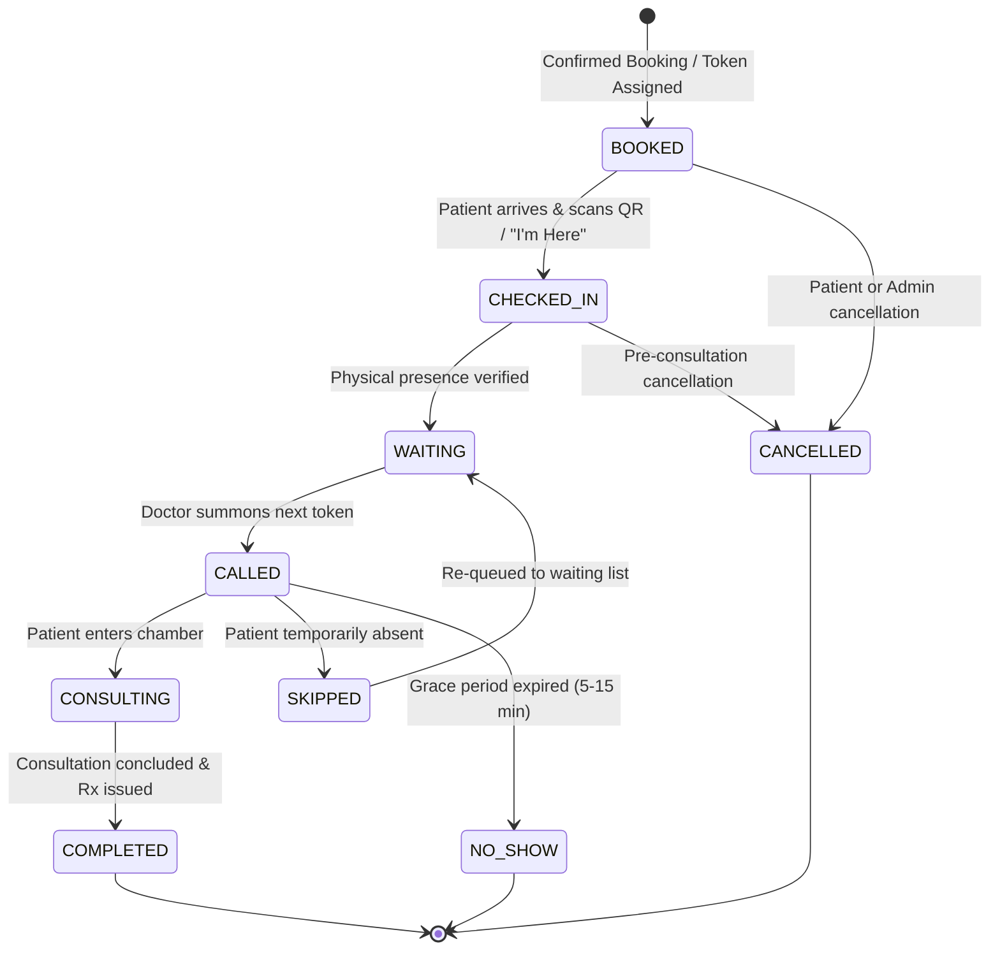
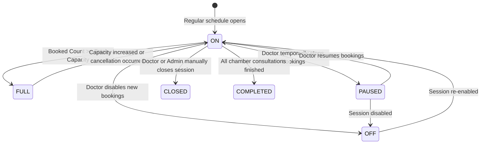

# MEDIQ — Queue Engine & Concurrency Specification

## 1. Multi-Chamber Queue Isolation Key
A critical rule of MEDIQ is that queues are never shared across doctors, chambers, or dates.
The universal partition key is:
```text
Queue Key = doctor_id + chamber_id + appointment_date
```
Every token sequence, waiting room list, capacity counter, and delay broadcast evaluates strictly within this partition.

---

## 2. Complete State Machines

### 2.1 Appointment & Queue State Transitions



#### Valid Transition Matrix
| From State | Allowed Target States | Triggered By | Side Effects |
| :--- | :--- | :--- | :--- |
| `BOOKED` | `CHECKED_IN`, `CANCELLED` | Patient / Staff / Admin | Record check-in timestamp or process refund & capacity release |
| `CHECKED_IN` | `WAITING`, `CANCELLED` | System / Staff | Position into active chamber waiting list |
| `WAITING` | `CALLED`, `SKIPPED`, `CANCELLED` | Doctor | Notify patient turn is approaching |
| `CALLED` | `CONSULTING`, `SKIPPED`, `NO_SHOW` | Doctor | Start session timer or trigger grace period counter |
| `SKIPPED` | `WAITING`, `NO_SHOW` | Doctor | Insert at tail or configured offset in queue |
| `CONSULTING` | `COMPLETED` | Doctor | Generate consultation record, advance queue, notify next patient |

*Rule*: Any unauthorized or out-of-order jump (e.g., `BOOKED` -> `COMPLETED`) is rejected by `QueueService::transition()` with `INVALID_STATE_TRANSITION`.

---

### 2.2 Doctor Availability State Machine



- **ON**: Open for new appointments if capacity permits.
- **FULL**: Automatic state when `booked_count == total_capacity`.
- **PAUSED**: Holds booking intake while keeping confirmed appointments intact.
- **OFF**: Closed for future bookings; existing appointments remain valid.
- **CLOSED / COMPLETED**: Session completed or officially locked.

---

## 3. Concurrency Control & Data Integrity Strategy

### 3.1 The "Two Patients, Last Slot" Problem (Atomic Slot Allocation)
When capacity is 20 and 19 slots are booked, two concurrent patients sending booking requests simultaneously must never result in 21 bookings.

```sql
-- Step 1: Start Transaction
START TRANSACTION;

-- Step 2: Acquire Pessimistic Row Lock on Capacity Record
SELECT total_capacity, booked_count 
FROM doctor_capacity
WHERE doctor_id = :doc_id 
  AND chamber_id = :chamber_id 
  AND appointment_date = :apt_date
FOR UPDATE;

-- Step 3: Server-side validation
-- IF booked_count >= total_capacity:
--    ROLLBACK;
--    RETURN Error: "CAPACITY_FULL"

-- Step 4: Increment Booked Count
UPDATE doctor_capacity
SET booked_count = booked_count + 1
WHERE doctor_id = :doc_id 
  AND chamber_id = :chamber_id 
  AND appointment_date = :apt_date;

-- Step 5: Atomic Token Generation from Sequence Counter Table
INSERT INTO doctor_token_sequences (doctor_id, chamber_id, appointment_date, current_sequence)
VALUES (:doc_id, :chamber_id, :apt_date, 1)
ON DUPLICATE KEY UPDATE current_sequence = current_sequence + 1;

SELECT current_sequence 
FROM doctor_token_sequences
WHERE doctor_id = :doc_id 
  AND chamber_id = :chamber_id 
  AND appointment_date = :apt_date;

-- Step 6: Construct formatted token (e.g. Prefix 'A' + 014 = 'A014')
-- Insert Appointment with Unique Compound Constraint (doc_id, chamber_id, apt_date, token_number)
INSERT INTO appointments (
  appointment_number, doctor_id, chamber_id, appointment_date, 
  patient_id, booked_by_user_id, token_number, token_display, status, ...
) VALUES (...);

-- Step 7: Auto-mark FULL if booked_count == total_capacity
UPDATE doctor_daily_availability 
SET status = 'FULL' 
WHERE doctor_id = :doc_id 
  AND chamber_id = :chamber_id 
  AND appointment_date = :apt_date 
  AND :new_booked_count >= :total_capacity;

-- Step 8: Commit Transaction
COMMIT;
```

### 3.2 Duplicate Payment Callback Idempotency
- Payment gateways may dispatch webhooks more than once due to network retries.
- Webhook processor initiates a transaction and acquires a row lock:
  ```sql
  SELECT status FROM payments WHERE transaction_ref = :ref FOR UPDATE;
  ```
- If the status is already `SUCCESSFUL`, the processor immediately commits and returns `HTTP 200 OK` with `{"idempotent": true}`.
- Under no circumstances will duplicate tokens or duplicate financial ledger rows be generated.

### 3.3 Race Condition on Queue Actions
- When doctor clicks "Start Consultation" on Token A009:
  ```sql
  UPDATE appointments 
  SET status = 'CONSULTING', consultation_start_time = NOW()
  WHERE id = :appointment_id AND status = 'CALLED';
  ```
- If `affected_rows == 0`, it indicates that another concurrent tab or staff device already triggered the action, returning an idempotent conflict code rather than corrupting queue status.

---

## 4. Smart Waiting-Time Calculation Algorithm

MEDIQ never displays a rigid single minute waiting time (e.g., "31 minutes"), because doctor consultations vary naturally based on patient condition. Estimates are presented as honest, realistic ranges (e.g., "25–40 min").

### 4.1 Variables
- $N_{ahead}$: Count of patients ahead in the queue with status in (`CHECKED_IN`, `WAITING`, `CALLED`) whose `sequence_number < patient.sequence_number`.
- $D_{avg}$: Rolling average duration (in minutes) of the last 10 completed consultations for this doctor today. If less than 3 consultations have finished today, default to the doctor's configured `slot_duration_minutes` (e.g., 10 mins).
- $D_{delay}$: Reported doctor delay in minutes (from `doctor_daily_availability.delay_minutes`).
- $T_{elapsed}$: Minutes elapsed since the current active patient entered `CONSULTING` state (clamped to a max of $D_{avg}$).

### 4.2 Formula
$$BaseWait = \max\left(0, (N_{ahead} \times D_{avg}) + D_{delay} - T_{elapsed}\right)$$
$$Wait_{Min} = \max\left(0, \text{round}(BaseWait \times 0.80)\right)$$
$$Wait_{Max} = \text{round}(BaseWait \times 1.25) + 5$$

### 4.3 Output Representation
- If $N_{ahead} == 0$ and current patient is `CONSULTING`: `"You are next (0–5 min)"`.
- If $BaseWait > 0$: `"{Wait_Min}–{Wait_Max} min"`.
- Clearly formatted notice: *"Estimates adjust live based on ongoing doctor consultations."*

---

## 5. Recommended Arrival Time Algorithm

To prevent patients from sitting in crowded waiting rooms for hours:
$$\text{Recommended Arrival Time} = \text{Current Time} + Wait_{Min} - \text{Safety Buffer (15 mins)}$$
- If $\text{Recommended Arrival Time} \le \text{Current Time}$, the display alerts: `"Please arrive at the chamber now."`
- Otherwise: displays the exact clock time (e.g., `"10:35 AM"`).

---

## 6. Check-In Verification Engine

Two check-in modes are supported:
1. **Secure QR Check-in**:
   - Chamber reception displays a daily dynamic QR code encoding a secure HMAC hash of `(doctor_id, chamber_id, appointment_date, daily_secret)`.
   - Patient mobile app scans the QR code; backend validates the signature and automatically transitions the appointment from `BOOKED` to `CHECKED_IN` and `WAITING`.
2. **"I'm Here" Button**:
   - Patient clicks "I'm Here" on mobile within 60 minutes of the chamber start time.
   - Requires patient confirmation and chamber staff validation.

---

## 7. No-Show & Grace Period Policy
- Configurable grace period stored in `system_settings` (`default: 10 minutes`).
- When a token is in `CALLED` status and the patient does not enter the consultation room:
  - Doctor can select **Skip** (moves patient to temporary hold; patient can be recalled).
  - Doctor can select **Mark No-Show** (recorded in `queue_events` and logs; slot is bypassed; wait-time estimates for subsequent patients immediately recalculate downward).
  - The appointment record is preserved for statistical audit; it is never deleted.

---

## 8. Concurrency-Safe Waitlist Engine
- When chamber status is `FULL`, patients can choose to **Join Waitlist**.
- If a confirmed appointment is cancelled:
  1. Transaction locks the oldest `WAITING` record in `waitlists`:
     ```sql
     SELECT id, patient_id FROM waitlists
     WHERE doctor_id = :doc AND chamber_id = :chamber AND appointment_date = :date AND status = 'WAITING'
     ORDER BY id ASC LIMIT 1 FOR UPDATE;
     ```
  2. The waitlist record transitions to `OFFERED` with an expiration timestamp (`now + 15 minutes`).
  3. Push & SMS notification is dispatched to the eligible patient.
  4. If patient confirms within 15 minutes, slot is booked. If the window expires, `WaitlistExpiterJob` marks it `EXPIRED` and offers the slot to the next patient in line.
